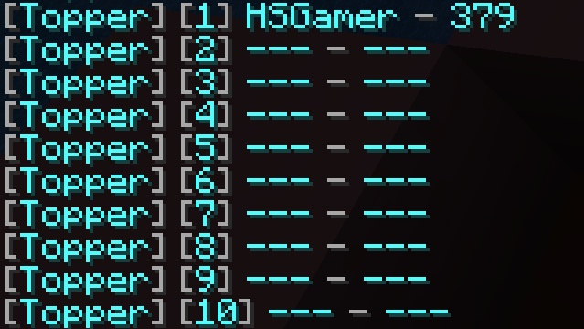
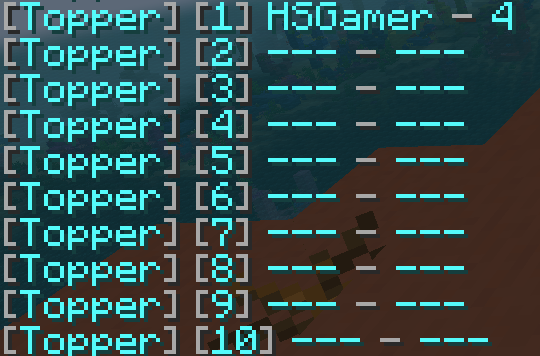

import { Tab, Tabs } from 'fumadocs-ui/components/tabs';
import { Step, Steps } from 'fumadocs-ui/components/steps';

This guide will quickly introduce you to the basics of Topper by creating a simple leaderboard.

Choose what kind of leaderboard you want to build:

<Tabs groupId="provider" items={['Statistic Provider', 'PlaceholderAPI Provider']}>
  <Tab value="Statistic Provider">
    **Statistic Provider** uses built-in Minecraft player statistics (such as jump count and mined blocks) without requiring any external plugins or mods.
  </Tab>
  <Tab value="PlaceholderAPI Provider">
    **PlaceholderAPI Provider** evaluates placeholders from PlaceholderAPI (Spigot) or Text Placeholder API (Fabric) to track data from external plugins or mods.
  </Tab>
</Tabs>

---

<Steps>

<Step>

## Add a Top Holder

The unit that stores and manages leaderboard data is called a **Top Holder**. Inside the Top Holder, you define a **Value Provider**, which is responsible for providing the value of each entry in the leaderboard.

We will start by creating a Top Holder named `jump` to count the number of times players jump.

<Tabs groupId="provider" items={['Statistic Provider', 'PlaceholderAPI Provider']}>
  <Tab value="Statistic Provider">

<Tabs groupId="platform" items={['SpigotMC', 'FabricMC']}>
  <Tab value="SpigotMC">

Open `plugins/Topper/config.yml`, head to the `holders` section, and add the following configuration:

```yaml
holders:
  jump: # The name of the Top Holder
    type: statistic # The type of the Value Provider
    statistic: jump # The vanilla statistic used to count player jumps
```

  </Tab>
  <Tab value="FabricMC">

Open `config/topper/config.json`, head to the `holders` section, and add the following configuration:

```jsonc
{
  "holders": {
    "jump": { // The name of the Top Holder
      "type": "statistic", // The type of the Value Provider
      "statistic": "minecraft:jump" // The vanilla statistic identifier
    }
  }
}
```

  </Tab>
</Tabs>

  </Tab>
  <Tab value="PlaceholderAPI Provider">

<Tabs groupId="platform" items={['SpigotMC', 'FabricMC']}>
  <Tab value="SpigotMC">

> [!NOTE]
> Requires [PlaceholderAPI](https://www.spigotmc.org/resources/placeholderapi.6245/). Make sure to download the Statistic expansion by running `/papi ecloud download Statistic` followed by `/papi reload`.

Open `plugins/Topper/config.yml`, head to the `holders` section, and add the following configuration:

```yaml
holders:
  jump: # The name of the Top Holder
    type: placeholder # The type of the Value Provider
    placeholder: "%statistic_jump%" # The placeholder evaluated for each player
```

  </Tab>
  <Tab value="FabricMC">

> [!NOTE]
> Requires [Text Placeholder API](https://modrinth.com/mod/placeholder-api). You can check its [Wiki](https://placeholders.pb4.eu/) for supported placeholders.

Open `config/topper/config.json`, head to the `holders` section, and add the following configuration:

```jsonc
{
  "holders": {
    "jump": { // The name of the Top Holder
      "type": "placeholder", // The type of the Value Provider
      "placeholder": "%player:statistic_raw minecraft:jump%" // The placeholder evaluated for each player
    }
  }
}
```

  </Tab>
</Tabs>

  </Tab>
</Tabs>

That is all you need to configure your first leaderboard!

</Step>

<Step>

## Reload the Server

Open your server terminal and type `/reloadtop` to apply the changes.

</Step>

<Step>

## Display the Top Holder

There are several ways to display the leaderboard of a Top Holder. In this case, we will simply display the top 10 players in the chat.

To display the top 10 jumping players, run:

```
/gettop jump 10
```



</Step>

<Step>

## Add another Top Holder

Now, let's add another Top Holder named `mine` to show the amount of diamond ores a player has mined.

<Tabs groupId="provider" items={['Statistic Provider', 'PlaceholderAPI Provider']}>
  <Tab value="Statistic Provider">

`mine_block` requires a block material to work. Hence, we add the `material` field to specify `diamond_ore`.

<Tabs groupId="platform" items={['SpigotMC', 'FabricMC']}>
  <Tab value="SpigotMC">

Open `plugins/Topper/config.yml` and add `mine` under `holders`:

```yaml
holders:
  jump:
    type: statistic
    statistic: jump
  mine:
    type: statistic
    statistic: mine_block
    material: diamond_ore
```

  </Tab>
  <Tab value="FabricMC">

Open `config/topper/config.json` and add `mine` under `holders`:

```jsonc
{
  "holders": {
    "jump": {
      "type": "statistic",
      "statistic": "minecraft:jump"
    },
    "mine": { // The name of the Top Holder
      "type": "statistic", // The type of the Top Holder
      "statistic-type": "minecraft:mined", // The category of the statistic
      "statistic": "minecraft:diamond_ore" // The block material identifier
    }
  }
}
```

  </Tab>
</Tabs>

  </Tab>
  <Tab value="PlaceholderAPI Provider">

<Tabs groupId="platform" items={['SpigotMC', 'FabricMC']}>
  <Tab value="SpigotMC">

Open `plugins/Topper/config.yml` and add `mine` under `holders`:

```yaml
holders:
  jump:
    type: placeholder
    placeholder: "%statistic_jump%"
  mine:
    type: placeholder
    placeholder: "%statistic_mine_block:diamond_ore%"
```

  </Tab>
  <Tab value="FabricMC">

Open `config/topper/config.json` and add `mine` under `holders`:

```jsonc
{
  "holders": {
    "jump": {
      "type": "placeholder",
      "placeholder": "%player:statistic_raw minecraft:jump%"
    },
    "mine": {
      "type": "placeholder",
      "placeholder": "%player:statistic_raw minecraft:mined minecraft:diamond_ore%"
    }
  }
}
```

  </Tab>
</Tabs>

  </Tab>
</Tabs>

Open your server terminal and type `/reloadtop` to apply the changes.

Now, you can display the top 10 diamond miners by running:

```
/gettop mine 10
```



</Step>

</Steps>

## What's next?

Now that your leaderboards are set up, explore more ways to display and customize them:
- Display rankings on [Signs](/topper/extra/block) or player [Heads / Skulls](/topper/extra/block).
- Integrate with [Holograms](/topper/extra/hologram) or [Citizens NPCs](/topper/extra/npc).
- Use [PlaceholderAPI Hook](/topper/hook/placeholderapi) or [MiniPlaceholders Hook](/topper/hook/miniplaceholders) to display leaderboard places anywhere in your chat, scoreboard, or tab list.
- Format numbers and times with the [Value Display System](/topper/extra/value_display).

Happy building! 🚀
